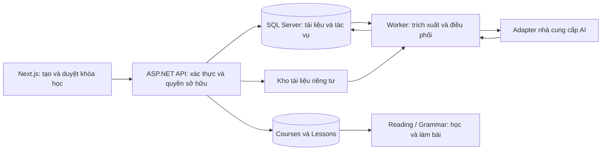

# Kế hoạch xây dựng chức năng tạo khóa học bằng AI

Ngày lập: 01/11/2026. Trạng thái: kế hoạch đề xuất, chưa triển khai tính năng.

Định hướng: học viên tải tài liệu, chọn mục tiêu học, duyệt dàn ý do AI đề xuất, sau đó nhận một khóa học cá nhân có bài học và bài tập sử dụng được trong LEWA. Bản đầu tiên tập trung Reading và Grammar. Đây là giả định phạm vi dựa trên mục “Tạo khóa học AI — Từ tài liệu, theo mục tiêu của bạn” đã có trong giao diện.

## 1. Cơ sở từ mã nguồn hiện tại

| Thành phần | Hiện trạng và ảnh hưởng đến kế hoạch |
| --- | --- |
| Frontend | Next.js và React; đã có danh mục khóa học, chi tiết khóa học, phiên đăng nhập qua cookie HttpOnly và proxy API. |
| Backend | ASP.NET Core, EF Core và SQL Server. Chưa thấy dịch vụ sinh khóa học bằng LLM hoặc worker xử lý tác vụ này. |
| Tài liệu nguồn | `UploadedDocuments` đã có người sở hữu, URL tệp, loại tệp, văn bản trích xuất, tóm tắt, khóa học được sinh và trạng thái tổng quát. |
| Khóa học cá nhân | `Courses.SourceType = user_upload` và `CreatedBy` đã có; catalog chỉ cho chủ sở hữu xem khóa học loại này, kể cả khi đã xuất bản. |
| Nội dung bài học | Đã có hợp đồng cho Speaking, Listening, Grammar, Writing và Reading. Nội dung lưu trong `Lessons.Content` bằng `LessonContentDocument` phiên bản 1. |
| Biên soạn | `CourseAuthoringService` đang dành cho khóa học hệ thống và API admin. Cần tách phần kiểm tra/đóng gói nội dung để dùng chung, đồng thời xây nghiệp vụ sở hữu riêng cho học viên. |
| Vào học | Luồng học viên hoàn chỉnh hiện có ở Listening. Preview Reading/Grammar trong admin chưa thay thế được API làm bài, lưu kết quả và màn hình học viên. |
| Lưu tệp | Adapter Cloudinary hiện phục vụ ảnh bìa và audio; chưa phải cơ chế tải/lưu PDF hoặc DOCX riêng tư. |
| Python | Có dependencies nền trong `requirements.txt`; chưa coi đây là một dịch vụ AI đã triển khai. MVP có thể điều phối trực tiếp trong .NET. |

Các điểm đối chiếu chính: [schema](DATABASE_SCHEMA.md), [quy tắc database](DATABASE_RULES.md), [authoring](backend/EnglishLearning.Api/Services/CourseAuthoringService.cs), [catalog](backend/EnglishLearning.Api/Services/CourseCatalogService.cs), [hợp đồng nội dung](backend/EnglishLearning.Api/Contracts/AdminCourseContracts.cs), [Reading/Writing](backend/EnglishLearning.Api/Contracts/ReadingWritingContracts.cs), [luồng học hiện tại](frontend/README.md).

## 2. Phạm vi bản đầu tiên

### Chức năng đưa vào MVP

- Người đã đăng nhập tải một PDF có lớp văn bản hoặc một DOCX cho mỗi lần tạo khóa học.
- Chọn trình độ CEFR, mục tiêu, Reading/Grammar hoặc cả hai, số bài và thời lượng mong muốn.
- AI tóm tắt tài liệu và đề xuất dàn ý. Người dùng sửa tên khóa học, tên bài, thứ tự và phạm vi trước khi yêu cầu sinh nội dung.
- Sinh nội dung, câu hỏi, đáp án và giải thích theo từng bài; hiển thị nguồn trang/đoạn để kiểm tra.
- Xem trước khóa học; xác nhận “Lưu và bắt đầu học” để đưa vào “Khóa học của bạn”.
- Có màn hình học Reading/Grammar, chấm bài tại backend, lưu kết quả, xem lại và cập nhật tiến độ.
- Xem lại các lần tạo đang xử lý, đang chờ duyệt hoặc bị lỗi; tiếp tục sau khi tải lại trang.

Giới hạn khởi điểm đề xuất: 10 MiB/tệp, PDF tối đa 30 trang, tối đa 50.000 ký tự sau trích xuất cho cả hai định dạng; mặc định 4–8 bài, tối đa 12 bài, 3–5 câu hỏi/bài. Một người có một tác vụ đang chạy và tối đa ba lần tạo/ngày. Các mức này cần điều chỉnh bằng benchmark trước khi mở rộng sử dụng.

Reading/Grammar MVP chỉ sinh trắc nghiệm và điền từ; Reading sử dụng trọng số câu hỏi bằng nhau. Cách này cho phép có luồng làm bài trọn vẹn trước khi mở thêm các dạng câu hỏi hiện có trong editor.

### Các đợt mở rộng

1. Ảnh/PDF scan với OCR; tạo lại riêng từng bài; hỗ trợ thêm dạng câu hỏi.
2. Listening với audio TTS và kiểm tra tính khớp giữa audio, transcript, câu hỏi; tái sử dụng luồng luyện nghe hiện có.
3. Speaking và Writing cùng màn hình học, tiêu chí đánh giá và cơ chế chấm tương ứng.
4. Tạo từ chủ đề/văn bản nhập trực tiếp, nhiều tài liệu, cộng tác hoặc chia sẻ khóa học. Cần chốt ý nghĩa nguồn khóa học và schema phù hợp trước khi mở các đầu vào không phải tệp.

## 3. Luồng người dùng

1. **Tài liệu và mục tiêu:** mở `/courses/create-ai`, tải tệp, chọn trình độ, kỹ năng và số bài. Hiển thị rõ phần văn bản trích xuất để phát hiện tệp không đọc được.
2. **Duyệt dàn ý:** xem tóm tắt tài liệu, mục tiêu từng bài, kỹ năng, thời lượng và đoạn nguồn. Sửa hoặc bỏ những bài không phù hợp rồi bấm “Tạo nội dung”.
3. **Theo dõi xử lý:** hiển thị bước hiện tại và số bài đã hoàn thành. Không đưa phần trăm ước lượng thành số đo chính xác; người dùng có thể rời trang rồi quay lại.
4. **Xem trước:** xem nội dung và bài tập; có thể bật đáp án trong chế độ xem trước. Khóa học chưa xuất hiện trong danh mục học cho đến khi xác nhận.
5. **Lưu và học:** lưu toàn bộ khóa học, bài học và liên kết tài liệu trong một transaction. Sau đó chuyển đến trang chi tiết, ghi nhận vào học khi người dùng bấm “Bắt đầu”.

Danh sách lịch sử tạo lấy theo người đăng nhập. Tệp không có văn bản, không đủ nội dung, có mật khẩu hoặc không phù hợp được giải thích bằng thông báo cụ thể và hướng xử lý.

## 4. Kiến trúc đề xuất

- **API .NET** quản lý quyền, giới hạn sử dụng, chuyển trạng thái, kiểm tra nội dung và ghi database. Chỉ backend giữ khóa nhà cung cấp AI.
- **Worker .NET** đọc tác vụ bền vững từ SQL Server, nhận lease có thời hạn, gia hạn khi đang chạy và tiếp tục từ checkpoint. Có thể khởi đầu bằng `BackgroundService`; bản thân vòng đời hosted service không thay thế việc lưu tác vụ. Tham khảo [Microsoft: hosted services](https://learn.microsoft.com/en-us/aspnet/core/fundamentals/host/hosted-services?view=aspnetcore-9.0).
- **Kho tài liệu riêng tư** nằm sau `IDocumentStorage`. Bản đầu dùng thư mục ngoài webroot trên volume bền vững của môi trường triển khai; truy cập qua API kiểm tra người sở hữu. Khi tách nhiều máy, cần adapter kho dùng chung trước khi scale.
- **Adapter AI** trả dữ liệu có cấu trúc qua JSON Schema/DTO; chọn nhà cung cấp và model bằng benchmark tài liệu thực tế. Không mặc định một model cụ thể hoặc đưa giá API cố định vào thiết kế.
- **Frontend** dùng proxy cùng origin và cookie HttpOnly hiện có; polling trạng thái có backoff, dừng khi kết thúc hoặc cần người dùng duyệt. HTTP tạo tác vụ trả `202` sau khi đã lưu yêu cầu bền vững.

## 5. Pipeline AI và kiểm tra nội dung

| Bước | Xử lý | Điều kiện đi tiếp |
| --- | --- | --- |
| 1. Nhận tệp | Kiểm tra quyền, định dạng thực, kích thước, số trang và giới hạn giải nén DOCX | Tệp hợp lệ, đã lưu riêng tư |
| 2. Trích xuất | Giữ ranh giới trang PDF/đoạn DOCX; làm sạch văn bản và chia đoạn có mã tham chiếu | Có đủ văn bản sử dụng được |
| 3. Lập dàn ý | Tóm tắt nguồn, phân bổ bài theo kỹ năng/trình độ và gắn đoạn nguồn | Dàn ý hợp lệ, chờ người dùng duyệt |
| 4. Sinh từng bài | Gửi mục tiêu, đoạn nguồn phù hợp và hợp đồng nội dung; checkpoint sau mỗi bài | Đủ nội dung và đúng cấu trúc |
| 5. Kiểm tra | Kiểm tra DTO, số lượng, độ dài, đáp án, câu trùng, mức độ bám nguồn | Toàn khóa hợp lệ, chờ xem trước |
| 6. Lưu khóa học | Kiểm tra lại kết quả và quyền; ghi Courses, Lessons và liên kết tài liệu | Transaction thành công, trả courseId |

Quy tắc nội dung:

- Hướng dẫn/giải thích mặc định bằng tiếng Việt; bài đọc và bài tập tiếng Anh theo trình độ đã chọn.
- Chủ đề và dữ kiện của bài đọc phải bám tài liệu. Ví dụ ngữ pháp do AI bổ sung phải phân biệt với trích dẫn nguồn.
- Với tài liệu không phải tài liệu dạy tiếng Anh, AI dùng chủ đề của nguồn để tạo bài tập ngôn ngữ; không khẳng định tài liệu có quy tắc ngữ pháp mà thực tế không có.
- Khi nội dung nguồn không đủ, giảm phạm vi dàn ý hoặc báo thiếu nội dung trước khi người dùng duyệt.
- Kiểm tra tất định: đúng skill/CEFR, đúng payload, lựa chọn hợp lệ, đáp án thuộc lựa chọn, câu điền từ có `[blank]`, không quá giới hạn hợp đồng hiện có.
- Chất lượng sư phạm và mức CEFR cần bộ mẫu đánh giá bởi người biên soạn; JSON đúng cấu trúc không chứng minh nội dung đúng.
- Lưu prompt version, model, token và thời gian xử lý trong dữ liệu tác vụ để so sánh chất lượng/chi phí. Các tham chiếu nguồn và checkpoint nằm ngoài `LessonContentDocument` phiên bản 1.
- Retry có giới hạn cho lỗi tạm thời; tôn trọng `Retry-After`. Lỗi JSON chỉ được sửa/tạo lại trong ngân sách quy định; nội dung còn lỗi không được kích hoạt.

## 6. Dữ liệu và độ bền của tác vụ

### Tận dụng schema đã có

| Dữ liệu | Cách sử dụng |
| --- | --- |
| `UploadedDocuments` | Chủ sở hữu, tên/loại tệp, định danh lưu trữ riêng tư, văn bản và tóm tắt; `GeneratedCourseId` được ghi khi lưu khóa học thành công. |
| `Courses` | `SourceType = user_upload`, `CreatedBy` lấy từ phiên backend. Sau khi người dùng xác nhận và nội dung hợp lệ, đặt `IsPublished = true`; quyền xem vẫn là của chủ sở hữu. |
| `Lessons` | Giữ hợp đồng JSON phiên bản 1, thứ tự bài, kỹ năng, trình độ và thời lượng hiện có. |
| `UserCourses`, `ExerciseResults`, `LearningProgress` | Đăng ký học, kết quả bài tập và tiến độ. Chốt quy tắc hoàn thành trong hợp đồng nghiệp vụ trước khi viết màn hình học. |

Không thêm loại nguồn `ai_generated` cho MVP từ tệp. Danh sách bài học vẫn theo `OrderIndex`; chưa đưa khái niệm module thành bảng mới. Ảnh bìa cá nhân có thể để trống và dùng artwork dự phòng đã có trong `CourseCover`.

`UploadedDocuments.Status` chỉ hỗ trợ `processing/completed/failed`. Không ghi các bước như `queued`, `generating` hay `awaiting_outline` vào cột này. Quy ước đề xuất: toàn quy trình chưa lưu khóa học là `processing`, lỗi là `failed`, đã lưu khóa học là `completed`.

### PROPOSAL — NOT APPROVED / CHỜ PHÊ DUYỆT — KHÔNG TRIỂN KHAI

Schema hiện chưa lưu được cấu hình tạo, dàn ý đang chờ duyệt, bản nháp, checkpoint và lease. Đề xuất **một bảng tác vụ `AiCourseGenerationJobs`** để đáp ứng khả năng tiếp tục sau restart; đây chưa phải schema chính thức.

| Cột đề xuất | Kiểu dự kiến | Mục đích |
| --- | --- | --- |
| `GenerationId` | `UNIQUEIDENTIFIER`, PK, NN | Định danh tác vụ; dùng làm khóa idempotency cho yêu cầu tạo |
| `DocumentId` | `INT`, NN, FK đến `UploadedDocuments.DocumentId`, UQ | Một tài liệu tải lên gắn một quy trình tạo trong MVP; người sở hữu suy ra từ tài liệu |
| `Status` | `NVARCHAR(32)`, NN | Trạng thái chi tiết của quy trình |
| `PayloadJson` | `NVARCHAR(MAX)`, NN | JSON có phiên bản: cấu hình, dàn ý, kết quả từng bài, checkpoint và thông tin đo lường; có giới hạn dung lượng ở ứng dụng |
| `ErrorCode` | `NVARCHAR(64)`, NULL | Mã lỗi an toàn để API ánh xạ thông báo |
| `AttemptCount` | `INT`, NN | Số lần nhận xử lý; giới hạn retry |
| `LeaseUntil` | `DATETIME2`, NULL | Thời hạn worker đang giữ tác vụ |
| `LeaseToken` | `UNIQUEIDENTIFIER`, NULL | Token fencing: worker đã mất lease không được ghi đè kết quả |
| `CreatedAt`, `UpdatedAt` | `DATETIME2`, NN | Thời điểm tạo/cập nhật để phục hồi, hết hạn và tra cứu |

Trạng thái đề xuất: `queued → extracting → planning → awaiting_outline → generating → validating → awaiting_review → completed`; `failed` lưu checkpoint bước bị lỗi. Hai trạng thái chờ duyệt không bị worker nhận lại. Outline chỉ được sửa khi đang `awaiting_outline`; lệnh generate chuyển trạng thái nguyên tử để tránh sinh hai lần.

Phạm vi thay đổi database dự kiến: thêm bảng tác vụ, PK, FK không cascade, UQ tài liệu và CHECK trạng thái của chính bảng này. Chi tiết index, default và mapping được đưa vào bản thiết kế schema khi duyệt; không mặc định thêm vào các bảng hiện tại. Yêu cầu lập kế hoạch chưa được coi là phê duyệt schema hay yêu cầu tạo/chạy migration, theo [DATABASE_RULES.md, mục 6](DATABASE_RULES.md#6-quy-tắc-xử-lý-yêu-cầu-chức-năng-mới).

Yêu cầu độ bền:

- `202 Accepted` chỉ trả sau khi lưu tệp và transaction tạo tài liệu/tác vụ thành công. Dọn tệp nếu ghi SQL thất bại; có quy trình thu gom tệp mồ côi.
- Frontend gửi UUID idempotency ổn định khi retry cùng một yêu cầu; backend đối chiếu chủ sở hữu và fingerprint đầu vào, trả tác vụ cũ hoặc `409` nếu dùng lại khóa với dữ liệu khác.
- Chỉ lưu checkpoint khi lease token còn hiệu lực. Không giữ transaction database trong lúc chờ model.
- Khôi phục tác vụ hết lease từ bài chưa hoàn thành; chấp nhận khả năng nhà cung cấp đã tính phí một lời gọi bị gián đoạn, đồng thời giới hạn tổng ngân sách.
- Kích hoạt khóa học phải khóa/kiểm tra trạng thái tác vụ trong transaction. Gọi lại sau khi thành công trả cùng `GeneratedCourseId`, không tạo khóa học thứ hai.
- Chốt thời hạn giữ tệp gốc, văn bản và bản nháp trong bước thiết kế; cleanup có kiểm tra trạng thái/lease và không xóa khóa học đang sử dụng.

## 7. API và giao diện cần xây

Các đường dẫn dưới đây là hợp đồng đề xuất, chưa phải API đã có.

| API backend | Chức năng |
| --- | --- |
| `POST /api/v1/ai-course-generations` | Nhận multipart tệp/cấu hình và `Idempotency-Key`; trả `202`, generationId và URL trạng thái |
| `GET /api/v1/ai-course-generations` | Danh sách có phân trang của người hiện tại |
| `GET /api/v1/ai-course-generations/{id}` | Trạng thái, số bài đã xong, dàn ý hoặc bản nháp theo giai đoạn |
| `PUT /api/v1/ai-course-generations/{id}/outline` | Kiểm tra và lưu dàn ý đã sửa khi đang chờ duyệt |
| `POST /api/v1/ai-course-generations/{id}/generate` | Xác nhận dàn ý và xếp xử lý nội dung |
| `POST /api/v1/ai-course-generations/{id}/retry` | Thử lại lỗi có thể phục hồi, giữ cấu hình/checkpoint và kiểm tra quota |
| `POST /api/v1/ai-course-generations/{id}/activate` | Lưu khóa học hợp lệ trong transaction và trả courseId |
| API học Reading/Grammar theo courseId/lessonId | Lấy đề, bắt đầu, nộp bài, xem kết quả và lịch sử |

Frontend bổ sung wizard tạo khóa học, màn hình tiến trình/tiếp tục, xem trước, lịch sử tạo và liên kết từ sidebar/catalog. Xây proxy allowlist cho đúng route/method, chặn body quá lớn khi đọc stream và kiểm tra same-origin theo cách các proxy hiện tại đang làm.

Luồng học Reading/Grammar phải tách response đề bài khỏi đáp án/giải thích; chấm tại backend, kiểm tra phiên bản nội dung khi nộp và giới hạn số câu trả lời. Preview của chủ khóa học có thể xem đáp án nhưng không ghi thành bài nộp. Điểm và trạng thái hoàn thành được tính từ kết quả đã lưu, không lấy từ client.

Quy tắc tiến độ đề xuất: một bài hoàn thành khi có ít nhất một lần nộp hợp lệ; tiến độ bằng số bài hoàn thành chia tổng bài đang hoạt động, độc lập với điểm số. Áp dụng qua dịch vụ tiến độ dùng chung cho các kỹ năng đã hỗ trợ và kiểm tra hồi quy Listening.

## 8. Bảo vệ dữ liệu và kiểm soát chi phí

- Kiểm tra chủ sở hữu ở mọi thao tác với tài liệu, tác vụ, preview và khóa học; trả `404` cho tài nguyên không thuộc quyền truy cập. Response cá nhân dùng private/no-store.
- Không dùng tên tệp gốc làm đường dẫn lưu; kiểm tra extension, MIME và nội dung thực; giới hạn giải nén DOCX và thời gian parser. Không tải URL ngoài từ nội dung tài liệu. Tham khảo [OWASP: File Upload](https://cheatsheetseries.owasp.org/cheatsheets/File_Upload_Cheat_Sheet.html).
- Văn bản tài liệu được coi là dữ liệu không tin cậy. Model chỉ sinh nội dung theo schema, không có quyền gọi công cụ, đọc secrets, ghi SQL hoặc xuất bản. Backend vẫn kiểm tra đầu ra độc lập; không coi prompt là biện pháp bảo vệ duy nhất. Tham khảo [OWASP: Prompt Injection Prevention](https://cheatsheetseries.owasp.org/cheatsheets/LLM_Prompt_Injection_Prevention_Cheat_Sheet.html).
- Chỉ gửi đoạn văn bản cần thiết cho model; thông báo việc xử lý qua dịch vụ AI tại bước tải tài liệu. Log dùng mã tài liệu/tác vụ, không ghi nguyên tệp, secrets hoặc toàn bộ prompt chứa dữ liệu cá nhân.
- Hạn mức theo người dùng phải được kiểm tra phía server bằng thao tác nguyên tử; kiểm soát cả số tác vụ, số lời gọi, token đầu vào/đầu ra và retry.
- Đo token, thời gian, tỷ lệ lỗi và chi phí mỗi khóa. Hiển thị ước lượng nếu có; chốt trần chi phí sau benchmark thay vì hứa một mức giá/thời gian chưa đo.

## 9. Kế hoạch triển khai

Ước lượng sơ bộ cho một lập trình viên full-stack làm toàn thời gian, đã có môi trường SQL Server và quyền gọi AI: **23–30 ngày công, khoảng 5–6 tuần**. Chưa bao gồm thời gian chờ quyết định schema/nhà cung cấp hoặc triển khai OCR/TTS.

| Giai đoạn | Công việc và đầu ra | Ngày công |
| --- | --- | --- |
| 1. Chốt thiết kế và thử nghiệm | Chốt MVP; wireframe; DTO; thiết kế schema tác vụ; thử parser và 2–3 model trên cùng bộ tài liệu; chốt quota, retention, ngân sách | 2–3 |
| 2. Tải tài liệu và xử lý nền | Kho riêng tư, upload, trích xuất, tác vụ bền vững sau khi schema được duyệt, lease/checkpoint, API trạng thái và phục hồi | 4–5 |
| 3. Pipeline sinh nội dung | Tóm tắt, dàn ý, duyệt, sinh từng bài, validator dùng chung, retry, đo lường và kích hoạt nguyên tử | 4–5 |
| 4. Giao diện tạo khóa học | Wizard, lịch sử, progress, sửa dàn ý, preview, lỗi, tiếp tục sau reload, liên kết catalog | 4–5 |
| 5. Học Reading/Grammar | API đề/chấm/lịch sử, màn hình học, lưu kết quả và tiến độ; tái sử dụng thành phần hiển thị phù hợp | 6–8 |
| 6. Nghiệm thu và phát hành thử | Kiểm thử tích hợp, lỗi/restart/phân quyền, đánh giá nội dung, quota, chi phí và hướng dẫn vận hành | 3–4 |

Thứ tự phụ thuộc: giai đoạn 1 chốt hợp đồng; 2 làm nền cho 3; 4 có thể phát triển theo mock DTO sau giai đoạn 1; 5 có thể thử bằng bài mẫu hợp lệ trước khi nối AI. Chỉ mở tính năng cho học viên khi cả tạo và học đều hoàn chỉnh.

## 10. Tiêu chí nghiệm thu

- PDF văn bản và DOCX hợp lệ tạo được khóa Reading/Grammar; từng bài có nội dung, câu hỏi, đáp án và giải thích đúng hợp đồng.
- Người dùng duyệt/sửa dàn ý; có thể rời trang và quay lại mà không mất trạng thái.
- Khởi động lại server ở bước trích xuất hoặc giữa hai bài không mất tác vụ, không tạo khóa học trùng; kiểm thử hai worker tranh cùng lease và lệnh kích hoạt đồng thời.
- Tệp scan, lỗi, có mật khẩu, quá dung lượng và tài liệu thiếu nội dung trả thông báo đúng; parser không vượt giới hạn tài nguyên.
- Model timeout, `429`, JSON sai và câu hỏi sai cấu trúc không làm xuất hiện khóa học chưa hợp lệ; retry dừng đúng hạn mức.
- Tài khoản khác không đọc được tệp, trạng thái, bản nháp, khóa học và kết quả; tài liệu chứa chỉ dẫn độc hại không làm model thực hiện hành động ngoài sinh nội dung.
- Reading/Grammar có thể bắt đầu, nộp, xem điểm/giải thích, làm lại và xem lịch sử; đề bài không chứa đáp án trước nộp. GET không tạo đăng ký học.
- Double-click hoặc gửi lại yêu cầu tạo/kích hoạt trả cùng tài nguyên; lỗi transaction không để khóa học được kích hoạt dở dang.
- Toàn bộ đầu ra được lưu phải qua kiểm tra cấu trúc. Dùng tối thiểu 20 tài liệu đại diện để người biên soạn đánh giá độ đúng, bám nguồn và phù hợp trình độ; mục tiêu pilot đề xuất là ít nhất 90% bài mẫu được đánh giá dùng được mà không cần sửa lớn, cùng trần chi phí/độ trễ được chốt sau benchmark.
- Chạy test .NET và test proxy/browser thích hợp; lint/build frontend; xác nhận authoring, catalog, Listening và media hiện có vẫn hoạt động.

## 11. Bước triển khai đầu tiên

Chuẩn bị hợp đồng request/response, wireframe wizard, bộ tài liệu benchmark và bản thiết kế chi tiết cho tác vụ bền vững. Hoàn thành việc duyệt schema tác vụ trước khi viết entity/mapping/migration liên quan. Có thể thực hiện mock giao diện và spike parser/model độc lập trong lúc chốt phần database.

Tài liệu này chỉ lập kế hoạch; không tạo bảng, chạy migration, thay đổi mã ứng dụng hoặc gửi tài liệu người dùng đến dịch vụ AI.
