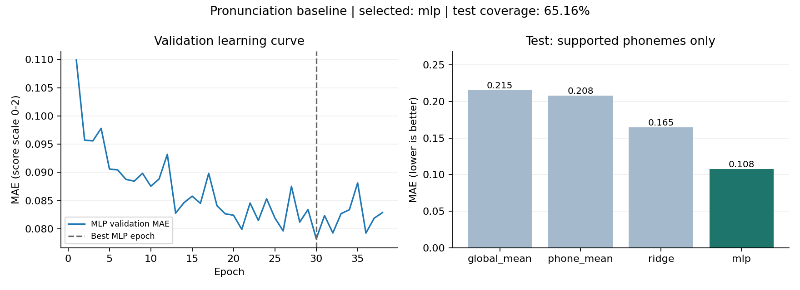

# Kết quả baseline chấm phát âm

Đã hoàn tất trích xuất GOP-CTC-align và huấn luyện trên máy hiện tại. Mô hình chọn bằng validation: **MLP**. Chạy 38 epoch; trọng số MLP tốt nhất ở epoch 30.

## Dữ liệu được sử dụng

| Tập | Câu gốc | Câu được hỗ trợ | Âm được chấm / âm gốc | Coverage |
|---|---:|---:|---:|---:|
| train | 2000 | 1776 | 24923 / 37750 | 66.02% |
| validation | 500 | 434 | 5891 / 9326 | 63.17% |
| test | 2500 | 2207 | 30865 / 47369 | 65.16% |

## Kết quả trên phần test được hỗ trợ

| Mô hình | MAE ↓ | RMSE ↓ | Pearson ↑ | Spearman ↑ |
|---|---:|---:|---:|---:|
| global_mean | 0.2152 | 0.3527 | Không xác định | Không xác định |
| phone_mean | 0.2083 | 0.3493 | 0.1420 | 0.2213 |
| ridge | 0.1646 | 0.3011 | 0.5438 | 0.3437 |
| mlp | 0.1079 | 0.2692 | 0.6509 | 0.4034 |

Thời gian trích xuất ghi nhận: 287.71 giây (không gồm nạp model ban đầu). Không có lỗi xử lý trong các câu đủ điều kiện.

## Phạm vi kết luận

Đây là baseline chấm điểm âm vị trên phần dữ liệu mapping được. Không so sánh trực tiếp với kết quả toàn bộ benchmark; chưa đánh giá người Việt và chưa kiểm chứng ranh giới âm bằng chuyên gia. Điểm phát âm thấp chưa cho biết chính xác học viên đã thay bằng âm nào.

Checkpoint: `checkpoints/pronunciation_scorer.pt`. Hướng dẫn chạy lại và dự đoán: `TRAINING.md`. Dữ liệu gốc không bị thay đổi.

