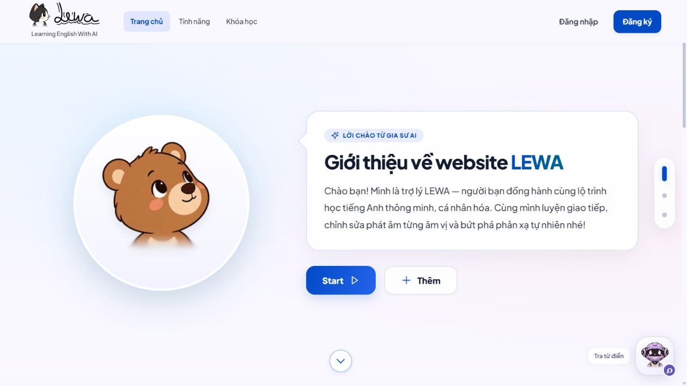

# Gộp nga vào Dat — 2026-11-04

Nguồn: Dat `e88ca2e` (đã lưu phần kết nối MongoDB local) và origin/nga `bb479227b6df32e1f9e665a6761ed9317014c084`. Bản gộp được xử lý/kiểm thử trên worktree riêng trước khi cập nhật project chính.

## Xung đột và cách xử lý

Có 10 file xung đột Git: Program.cs, HealthController.cs, hai NuGet lockfile, hai README, npm lockfile, hai trang khóa học và CSS khóa học. Đã giải quyết bằng cách giữ chức năng của cả hai nhánh.

- Dat: Speaking theo cụm/câu, màu phản hồi âm/từ, hồ sơ/ảnh đại diện và Flashcards cá nhân/chung.
- Nga: Listening và lịch sử/kết quả, Reading/ảnh bài đọc, quản trị ẩn/hiện khóa học, từ điển MongoDB và Cloudinary.
- Khóa học có cả Speaking và Listening giữ đúng hai đường luyện độc lập; CEFR Speaking vẫn đủ A1–C2; tiến độ nghe không bị thay bằng tiến độ nói.
- Bản auto-merge có hai section MongoDbSettings trùng nhau dù không có marker. Đã hợp nhất thành một section.
- Lockfile frontend đã tái tạo; lỗi npm ci của bản nga ban đầu được khắc phục.
- Giữ SHA256 của reference_mapping.py khớp artifact hiệu chỉnh, không thay model đã train.

## Tương thích media

Thêm lựa chọn rõ ràng MediaStorage:EnableDevelopmentLocalStorage. Chỉ dùng kho local khi Development, cờ được bật và Cloudinary tắt. Nếu bật Cloudinary thì luôn dùng cloud; lỗi cloud không tự chuyển sang local. Ngoài Development, cờ local không có hiệu lực. Health phản ánh đúng local-development hoặc chế độ cloud.

Đã sửa GET media để trả 503 khi storage chưa được cấu hình thay vì lỗi 500 chung. Thêm 7 test chức năng cho chọn provider, lưu/đọc local, xử lý lỗi cloud và phản hồi 503.

API Key/Secret và cấu hình tài khoản Cloudinary do người dùng cung cấp được lưu trong User Secrets, bên ngoài repository. Kiểm tra ping có xác thực trả HTTP 200/status ok; bật cấu hình local sau khi xác thực. Không upload, migrate hoặc xóa asset cloud trong lượt này.

## Kiểm thử

| Kiểm tra | Kết quả |
|---|---|
| Backend build và bộ test cuối | 277 đạt, 0 lỗi, 63 bỏ qua; tổng 340 |
| npm ci sạch từ lockfile gộp | Đạt |
| Frontend ESLint, typegen, TypeScript | Đạt |
| Next production build | Đạt, 33 trang |
| Speaking frontend | 43 đạt, 1 live test tùy chọn bỏ qua |
| Test render khóa học sau merge | 3 đạt |
| Proxy Listening / Cloudinary media / quản trị khóa học | 3 suite đạt |
| API health / SQL health / Mongo health | HTTP 200 |
| Health media khi kiểm tra độc lập với cloud tắt | HTTP 200, local-development |
| Cloudinary ping có xác thực | HTTP 200, status ok |
| Trang chủ và đăng nhập sai trên browser, localhost | Hiển thị và phản hồi đúng |

OpenAPI của bản gộp có 5 route Speaking, 7 Listening, 6 Flashcards, 3 từ điển và PUT /api/v1/auth/me cho cập nhật hồ sơ. Các số đếm là số đường dẫn, không phải số test.

Các test cần SQL/Mongo integration hoặc dịch vụ ngoài vẫn cần opt-in riêng. Không chạy lại live model Speaking trong lượt này. Không kiểm chứng upload/delivery Cloudinary thật; ping chỉ xác nhận kết nối/xác thực.

Không thay đổi entity/model/schema/migration SQL so với Dat; không chạy migration, initialize-vocabulary, bootstrap tài khoản, seed hoặc ghi dữ liệu ứng dụng. Cấu hình SQL/Mongo riêng của máy được giữ lại khi áp dụng bản gộp.

Địa chỉ localhost được xác nhận cho đăng nhập. Vấn đề kiểm tra Origin khi dùng 127.0.0.1 đã tồn tại ở phần auth chung và được ghi rõ trong README; không tắt bảo vệ Origin trong lượt merge này.

## Bằng chứng

- Backend TRX: backend/EnglishLearning.Api.Tests/bin/merge-validation/test-results/dat-nga-final.trx trong worktree kiểm thử.
- Log frontend và runtime nằm trong thư mục validation-artifacts của worktree.
- Quét các file thay đổi không phát hiện giá trị API Key/Secret Cloudinary; không đưa backup cấu hình local hoặc User Secrets vào commit.

