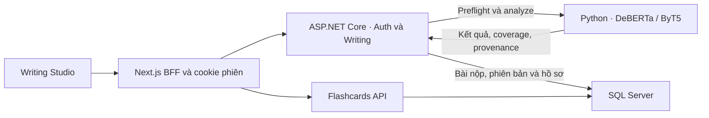

# Kiến trúc và luồng dữ liệu Writing

## Auth, đề bài, nộp và đọc kết quả

- [Trang Writing](../../frontend/src/app/writing/page.tsx) đọc người dùng, thư viện đề và bài nộp cần mở. [WritingForm](../../frontend/src/app/writing/writing-form.tsx) giữ nội dung nháp, mode sửa lỗi, trạng thái token preflight, nộp bài và thông báo khi dependency lỗi. [writing.ts](../../frontend/src/lib/writing.ts) kiểm tra DTO về phía client.
- [Route thư viện đề](../../frontend/src/app/api/writing/tasks/route.ts) đi tới [WritingTasksController](../../backend/EnglishLearning.Api/Controllers/WritingTasksController.cs). [WritingTaskLibrary](../../backend/EnglishLearning.Api/Services/WritingTaskCatalogue.cs) chỉ mở trên Development và xác minh file catalogue cục bộ cùng hash/version. Frontend gửi `taskId` và `taskVersion` cho đề thư viện hoặc nhập `topic` khi tự đặt đề. Backend tự xác minh và lưu snapshot đề. `checkedRequirements` và hướng dẫn số từ là công cụ tự kiểm ở frontend.
- [Capabilities](../../frontend/src/app/api/writing/capabilities/route.ts) và [preflight](../../frontend/src/app/api/writing/preflight/route.ts) gọi .NET rồi hỏi khả năng/token budget của AI. Kết quả có thể yêu cầu người học xác nhận xử lý GEC một phần; việc kiểm quota không tạo lần nộp.
- [Proxy nộp bài](../../frontend/src/app/api/writing/submissions/route.ts) chuyển phiên xác thực đến `POST /api/v1/writing/submissions`, chặn trường ngoài contract như `targetCefr`. [WritingController](../../backend/EnglishLearning.Api/Controllers/WritingController.cs) kiểm JWT và chủ sở hữu bài nguồn, đọc `parentSubmissionId`, `requestId` và task refs. [WritingContracts.cs](../../backend/EnglishLearning.Api/Contracts/WritingContracts.cs) định nghĩa request, version và dữ liệu phân tích.
- [WritingAiClient](../../backend/EnglishLearning.Api/Services/WritingAiClient.cs) gửi `text` và `corrections` vào `/internal/writing/analyze` trong [serve.py](../../ai/writing/serve.py). [WritingEngine](../../ai/writing/inference.py) dùng DeBERTa để ước lượng CEFR và ByT5 để tạo bản sửa câu khi bật GEC. AI phân loại theo bài, không dùng topic/prompt cho runtime CEFR hiện tại. Khi GEC skip hoặc guard chặn, coverage và warnings phân biệt nguyên nhân. `WritingAiClient` kiểm kết quả, giới hạn chuỗi, provenance, offset UTF-16 và coverage trước khi lưu. Xem [phân tích AI](04_GEC_MODEL_AND_FAILURES.md).
- [AuthController](../../backend/EnglishLearning.Api/Controllers/AuthController.cs) lưu mục tiêu ở `Users.TargetLevel`. [Profile](../../PROFILE.md) là nơi chỉnh mục tiêu. Khi nộp bản mới, controller đọc hồ sơ hiện tại từ server trong transaction và đưa snapshot vào `ErrorsJson.practice.targetCefr`. `WritingSubmissions.CefrLevel` là prediction độc lập. Mục tiêu null được ghi thành snapshot nếu hồ sơ chưa có giá trị. Bài cũ tiếp tục hiển thị snapshot lịch sử hoặc trạng thái chưa được ghi.
- Transaction SQL dùng `sp_getapplock` theo user để kiểm lại request key, cấp version và ghi row mới. Retry khớp payload trả kết quả đã lưu, còn key dùng lại với payload khác gây conflict. Lịch sử và bản gốc giữ nguyên qua lần nộp mới. [Chi tiết bài](../../frontend/src/app/api/writing/submissions/%5BsubmissionId%5D/route.ts), [lượt luyện](../../frontend/src/app/api/writing/practices/route.ts), và [giao diện lịch sử](../../frontend/src/app/writing/writing-history.tsx) duyệt bản đã lưu theo chủ sở hữu. Xem [giới hạn SQL](08_DATABASE_AND_PENDING_WORK.md).

## Review, feedback và Flashcards

- [WritingComparison](../../frontend/src/app/writing/writing-comparison.tsx) trình bày bài gốc và bản nháp. [writing-revision.ts](../../frontend/src/lib/writing-revision.ts) ánh xạ diff/spans và áp sửa trên bản gốc có vị trí xác minh. [writing-review.ts](../../frontend/src/lib/writing-review.ts) dựng danh sách nhận xét, loại/trạng thái và khôi phục quyết định. Chỉnh tay ngoài bản nháp được kiểm soát có thể làm lệch span. [writing-draft.ts](../../frontend/src/lib/writing-draft.ts) tách nháp theo người dùng, bài nguồn và đề trong `sessionStorage`.
- [Proxy feedback](../../frontend/src/app/api/writing/submissions/%5BsubmissionId%5D/feedback/route.ts) gọi endpoint riêng theo bài đã lưu. Backend có thể gửi essay text, prompt/topic và gợi ý lỗi cho local feedback nếu bật. Feedback thử nghiệm tắt mặc định và không phải bộ chấm bám đề đã kiểm định. Lỗi/timeout feedback có thể thử lại từ bản lưu. Khi analyze chưa có kết quả hợp lệ, API không lưu prediction giả, frontend giữ nháp.
- [WritingFlashcards](../../frontend/src/app/writing/writing-flashcards.tsx) qua [proxy Flashcards](../../frontend/src/app/api/flashcards/%5B...path%5D/route.ts) xem ứng viên từ `GET /api/v1/flashcards/writing/{submissionId}`, xem các bộ thẻ và tự chọn thẻ cần lưu. [WritingCardCandidates](../../backend/EnglishLearning.Api/Services/WritingCardCandidates.cs) dùng thay đổi có bằng chứng từ GEC và 17 mẫu local. Người dùng có thể sửa mặt trước, mặt sau và ví dụ. [FlashcardsController](../../backend/EnglishLearning.Api/Controllers/FlashcardsController.cs) xác minh lại bài nguồn và bộ thẻ, sau đó `POST /api/v1/flashcards/decks/{id}/writing/{submissionId}` tạo hoặc trả thẻ hiện có. Lịch ôn dùng SM-2 của bộ thẻ chung. `validatedSource` chỉ chứng minh nguồn ở lần nhập.
- Mã regression gần luồng gồm [WritingTaskTests](../../backend/EnglishLearning.Api.Tests/WritingTaskTests.cs), [WritingVersionTests](../../backend/EnglishLearning.Api.Tests/WritingVersionTests.cs), [FlashcardTests](../../backend/EnglishLearning.Api.Tests/FlashcardTests.cs) và [frontend Writing tests](../../frontend/tests/writing-tasks.test.cjs).
